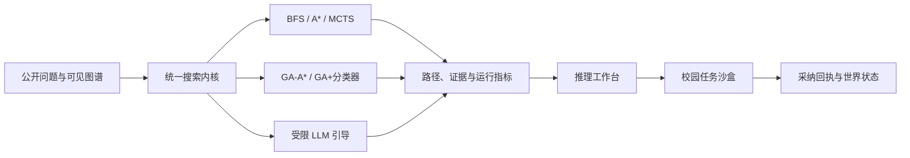

# CampusEcho 校园回响 0.3.0

CampusEcho 是一个可审计的知识图谱多跳问答与校园任务采纳工作台。用户从公开问题卡或图谱实体出发，在 BFS、A*、GA-A*、GA+分类器、MCTS 与受限 LLM 引导之间比较搜索路径；选中可信结论后，可把候选答案、证据、人员与资源约束带入校园沙盒，再通过服务端回执确认方案是否写入任务。学术层事实与虚构校园层使用同一套图、问题和搜索合同，推理过程只读取公开问题、可见图结构与来源元数据。

知识图谱当前包含 504 个实体、1234 条三元组和 28 个来源，覆盖 20 类关系。公开问题集合包含 662 个 core 问题和 112 个 robust 问题，问题路径跨 2 至 4 跳。数据按 family_id 划分为 train、val、test，实体占比依次为 59.72%、19.64%、20.63%；同一家族的实体、三元组和问题保持在同一划分。学术层收录 6 篇论文及其 arXiv、OpenAlex 元数据，校园层全部为虚构人物、社团、活动和地点。公开文件不保存答案或路径，私有标注仅由评测器读取。

## 架构



统一搜索内核位于 `kg_search.py`，BFS、A* 与 MCTS 共享状态、预算和事件记录，可比较展开节点、候选检查、冗余路径与 rollout 工作量。`kg_learning.py` 使用四维结构特征训练 GA 启发权重和 L2 逻辑回归路径分类器；特征只描述目标邻近度、证据支持、路径效率和前沿平衡，不包含实体 ID、答案或测试标签。`kg_hybrid.py` 把 GA、分类器与 LLM 评分接入 A* 排序，并保留最终路径由本地搜索验证的边界。

`llm_gateway.py` 连接 OpenAI 兼容端点，支持模型名单刷新、响应缓存、调用计量与安全降级。LLM 只能给已有候选动作或路径重排和解释，输出经过字段、范围、候选集合与证据引用校验；网络失败、非法 JSON、越界分数或未配置凭据时，搜索继续使用本地启发式并记录降级状态。`research_api.py` 提供图谱、问题、搜索、运行读取与校园采纳接口，`api.py` 是 FastAPI 入口，`static/research.html` 与 `static/research.js` 构成默认推理工作台。

校园世界由不可变 `WorldState` 和角色可见的 `AgentView` 分层保存。世界真值、外部日程与随机种子留在执行侧；角色视图只包含已收到且已发生的观察、本人记忆、合法动作和公开任务进度。规则、Bayes 与 D-S 使用同一份可见证据，策略输出再交给执行器校验。任务采纳会检查真实搜索运行、有效答案路径、行动时间和人员资源，成功后返回回执、路线与更新后的世界状态。

## 运行

项目要求 Python 3.12 或更高版本。在项目根目录创建环境并安装开发与 Web 依赖：

```powershell
python -m venv .venv
.\.venv\Scripts\python.exe -m pip install -e ".[dev,web]"
```

启动默认推理工作台：

```powershell
.\.venv\Scripts\python.exe -m campusecho serve --port 8842
```

浏览器访问 `http://127.0.0.1:8842/`。首页提供知识搜索与校园沙盒；`http://127.0.0.1:8842/classic` 保留机制实验界面。知识搜索可逐帧播放搜索树、查看证据路径，并运行五种策略的同题对照。沙盒提供找到小汐、传达活动改址和雨天送伞三个任务，采纳成功后显示回执并同步角色现场。

命令行也可以直接检查机制案例或运行初步基准：

```powershell
.\.venv\Scripts\python.exe -m campusecho demo --scenario duplicate
.\.venv\Scripts\python.exe -m campusecho benchmark --cases 30 --output artifacts/smoke_metrics.json
```

## 实验复现

知识图谱正式对比实验的冻结结果位于 `artifacts/kg/formal_test_20261118`。该次运行使用 160 个 test 问题，五种方法各生成一条结果，共 800 条记录；GA 与分类器只用 train、val 数据拟合，参数冻结后才评测 test。结果目录包含逐题记录、聚合指标、冻结参数、协议、数据与源码指纹以及文件哈希清单。

重新运行正式对比时，把输出写到新的空目录：

```powershell
.\.venv\Scripts\python.exe tools\run_kg_experiment.py --output artifacts/kg/repro_20261118
```

可用 `--split`、`--limit`、`--methods`、`--seed` 等参数控制评测范围；默认输出目录已存在内容时会拒绝覆盖。冻结结果可用下列命令复核：

```powershell
.\.venv\Scripts\python.exe -m pytest -q tests\test_kg_experiment.py tests\test_kg_search.py tests\test_kg_learning.py tests\test_kg_hybrid.py tests\test_research_api.py
```

受控校园模拟研究位于 `artifacts/research`。默认数据生成器创建 3000 条训练轨迹、1000 条验证轨迹和 1000 条测试轨迹，每条轨迹保留三张快照。正式静态实验比较规则、Bayes、强 Bayes、D-S 变体与混合方法；动态实验让五种策略共享初始世界和外部日程，记录成功、错过、改约、询问、额外路程、时间与约束违规。小样本检查应写入独立目录：

```powershell
.\.venv\Scripts\python.exe tools\run_research.py --smoke --output artifacts/research_smoke
```

完整正式重跑使用 `tools\run_research.py --output artifacts\research`。既有冻结结果可用 `artifacts\research\audit_static.py`、`artifacts\research\audit_dynamic.py`、`artifacts\research\supplemental\audit.py` 和 `artifacts\research\ablation\audit.py` 复核。补充实验与消融脚本采用预注册流程，已有协议或结果时拒绝覆盖；重新研究应新建输出目录和协议。

## LLM 配置

工作台默认的 LLM 引导模式在 `DEEPSEEK_API_KEY` 存在时创建网关，端点默认为 `https://api.deepseek.com/v1`。通用 `LLMGateway` 还支持 OpenAI 兼容网关，通过 `AXONHUB_BASE_URL` 与 `AXONHUB_API_KEY` 配置端点和凭据。凭据只从环境变量或显式传入的私有配置读取，不写入响应、缓存键或日志。

```powershell
$env:DEEPSEEK_API_KEY = "<api-key>"
.\.venv\Scripts\python.exe -m campusecho serve --port 8842
```

模型选择只接受实时名单与本地评分表交集中的已核验模型，未知模型不会被猜测评分。调用失败或响应不合规时，网关返回降级状态，页面与实验记录仍保留本地搜索结果。LLM 子集最多 60 个问题，所有搜索方法共享同一子集；私有答案不会传给评分器。

## 交付物

源码、知识图谱、测试和可复现实验脚本都位于项目目录。冻结 KG 结果位于 `artifacts/kg/formal_test_20261118`，课堂材料、研究图和构建回执位于 `artifacts/report3`。最终课堂交付位于上一级 `课程交付材料/当前交付`，包含课堂报告、两分钟汇报、真实运行演示、研究图、运行说明和哈希清单。

主要文档入口包括 `docs/report3.md`、`docs/report3_speech.md`、`docs/CampusEcho_运行与验收说明.md` 和 `docs/report3_interface.md`。知识图谱结果来自冻结实验；页面中的 LLM 实网收益、真实校园外部适用性以及浏览器跨设备体验需要在对应环境继续验证。

## 检查

```powershell
node --check src\campusecho\static\research.js
.\.venv\Scripts\python.exe -m pytest -q
.\.venv\Scripts\python.exe -m ruff check src tests
```

测试覆盖图谱 schema、公开与私有数据隔离、搜索预算与确定性、GA 与分类器训练边界、LLM 输出校验、API 搜索与采纳、世界快照回放、概率推理和实验产物一致性。性能数值来自本机单进程运行，用于当前实现比较，不构成硬件无关的速度保证。
