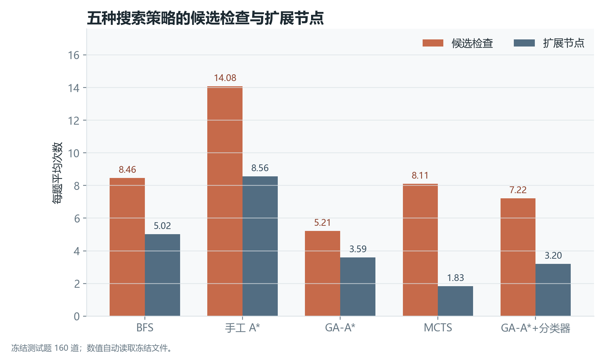
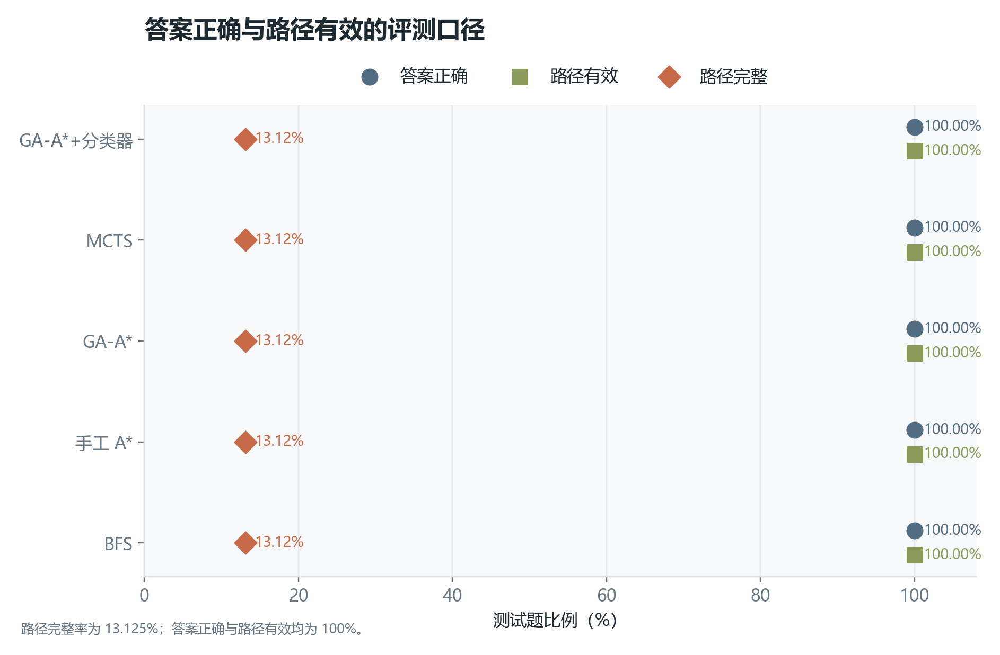
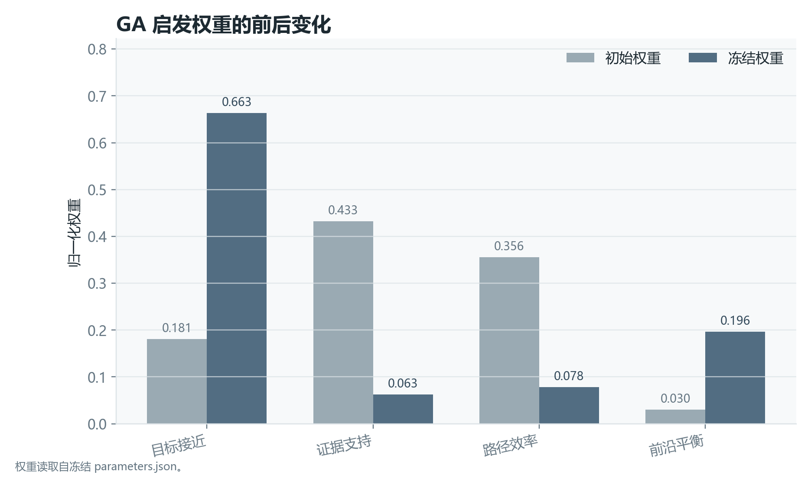
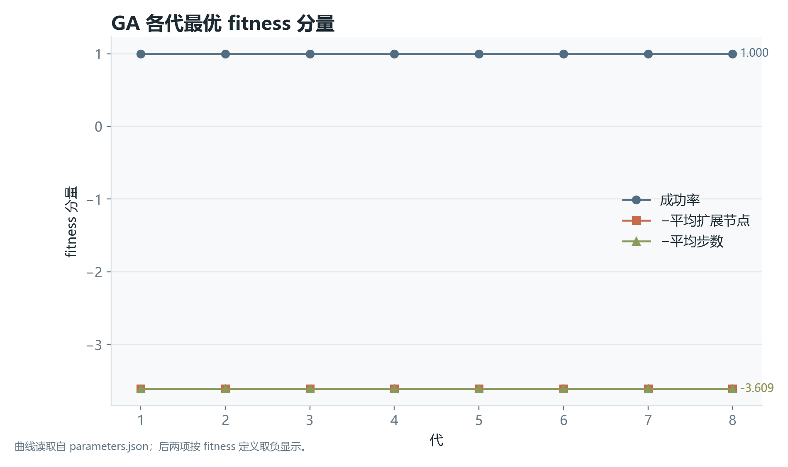
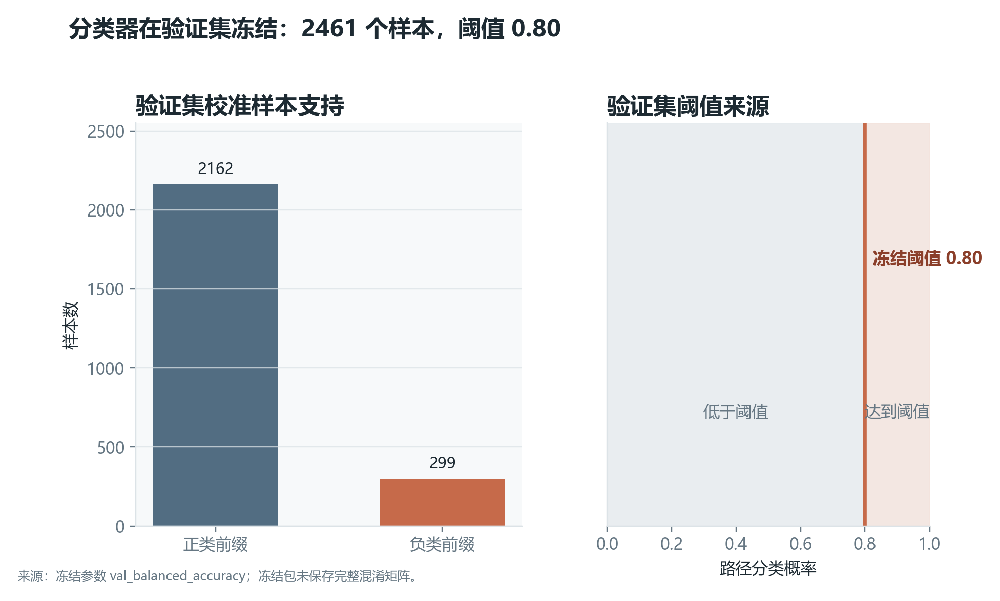

# 面向校园多跳问答的知识图谱混合搜索：GA-A\*、MCTS与受约束LLM辅助

第24组

成员：徐阳、廖信同、黎欣欣、周艳雯、殷浚峰

日期：2026-11-18

## 摘要

校园互动中的问题经常横跨人物、社团、活动、地点与学术资料。回答这类问题既要沿关系找到若干跳之外的目标，也要保留能够核验的推理路径。本文围绕 CampusEcho 的可审计知识图谱，研究广度优先搜索、A\*、蒙特卡洛树搜索、遗传算法优化的 A\* 以及路径价值分类器增强的 A\* 在同一批固定跳数问题上的表现。知识图谱包含 504 个实体和 1234 条三元组，核心问题集有 662 题，稳健问题集有 112 题，问题跳数限定为 2 至 4 跳。正式测试使用 160 道题，五种方法各运行一次，共形成 800 条记录。

实验结果显示，五种方法的答案准确率与路径有效率均为 1.0。测试集包含 107 道可解题和 53 道无解题；五种方法对 107 道可解题均返回至少一条标准有效路径，对 53 道无解题均返回空集。平均扩展节点数和候选检查数分别为：BFS 5.01875 与 8.45625，手工 A\* 8.5625 与 14.08125，GA-A\* 3.59375 与 5.2125，MCTS 1.83125 与 8.10625，GA-A\* 加分类器 3.2 与 7.21875。GA-A\* 相对 BFS 减少约 28.39% 的扩展节点和 38.36% 的候选检查。MCTS 的树节点扩展数最低，但该计数不包含 rollout，必须结合 8.10625 次候选检查和 8 步 rollout 上限解释。GA-A\* 加分类器进一步降低扩展节点，却把候选检查提高到 7.21875，呈现搜索深度与分支检查之间的交换。严格全路径完整率在各方法上均为 0.13125，即每种方法只有 21 题返回全部标准路径。其余 139 题中，53 题的标准路径集合为空且预测也为空，因当前完整率实现要求预测路径非空而被计为未完整；86 题返回标准路径的非空真子集。本文把完整率作为补充指标，并结合主指标和冻结记录解释其含义。

本文贡献包括：构建带时间、来源、划分和私有答案隔离的多跳知识图谱；在同一分层状态空间中比较 BFS、A\* 与 MCTS；用遗传算法学习四维启发权重；用验证集校准的路径价值分类器与专家规则共同约束搜索；设计只提供候选动作或已验证路径的 LLM 辅助接口，使动作合法性、路径奖励和解释引用由本地确定性逻辑裁决。官方 DeepSeek 兼容接口已经完成真实模型列表、候选评分和路径解释调用，并验证非法动作拒绝与证据引用校验；正式冻结的 800 条搜索记录没有把 LLM 评分混入算法对照，因此本文不把一次接口验证写成已经获得稳定收益的结论。

关键词：知识图谱；多跳问答；A\*；蒙特卡洛树搜索；遗传算法；路径价值分类；受限大语言模型

## 1 引言

校园问答通常从一个对象出发，经过多条关系才能得到答案。例如，从“某位同学”出发，先沿 `MEMBER_OF` 找到社团，再沿 `ORGANIZES` 找到活动，最后沿 `HELD_AT` 得到地点；如果问题还要求返回全部简单路径，搜索过程就必须区分“找到某个终点”和“枚举全部固定跳数路径”。前者适合评价问答是否可用，后者适合评价证据覆盖是否完整。两类目标对应不同的搜索停止条件，也要求报告分别解释答案准确率、路径有效率和路径完整率。

知识图谱问答已有检索增强生成、图结构检索和多跳推理等研究路线。Lewis 等将外部检索与生成模型结合，说明知识密集型任务可以从非参数化知识中获得支持[8]；Yang 等构建的 HotpotQA 强调多文档推理与可解释支持事实[9]；Peng 等从图索引、图检索和生成三个环节综述了 GraphRAG[10]。这些工作表明，图结构能够把实体关系和多跳依赖显式化。本文聚焦一个更窄但可审计的问题：在固定跳数、固定关系白名单和公开图结构下，如何比较不同搜索策略，并在不泄露私有答案的前提下加入学习排序与 LLM 辅助。

本文使用虚构校园层与公开学术元数据层共同构成知识图谱。校园层中的人物、社团、活动和地点均为虚构对象，学术层收录 Transformer、BERT、RAG、VGG、ResNet 与 Word2Vec 六篇论文及其模型、方法、数据集、模态、出版信息和主题关系[11-15]。这种组合既能提供贴近校园情境的多跳关系，也能提供来源可追溯的学术实体。所有问题只暴露起点、方向、跳数、关系白名单和截止日期，答案与完整路径保存在评测器私有标注中。

研究问题包括四个方面。第一，分层状态表示能否让 BFS、A\* 和 MCTS 在相同候选与预算口径上比较。第二，遗传算法学习的四维启发权重能否减少 A\* 的扩展节点与候选检查。第三，路径价值分类器能否在专家规则约束下进一步改善排序，以及改善是否伴随候选检查增加。第四，LLM 能否在只看到公开候选和已验证路径时提供动作意见或解释，同时由本地逻辑阻止它生成答案、伪造动作或引用不可见证据。

## 2 知识图谱与多跳问题

### 2.1 数据构成与来源边界

冻结数据清单记录 28 个来源、504 个实体和 1234 条三元组。实体被划分为 301 个训练实体、99 个验证实体和 104 个测试实体，划分比例为 0.5972、0.1964 和 0.2063。划分单位是 `family_id`，同一家族的实体、三元组和问题进入同一集合，避免同一关系模板同时出现在拟合与测试阶段。学术层使用论文和 OpenAlex 元数据，校园层全部标记为虚构来源。清单还保存图、公开问题、私有标注和清单文件的字节数与 SHA-256，正式实验的源码哈希覆盖数据加载、搜索、学习、实验运行器和相关测试。

知识图谱的关系白名单包含 20 种关系。学术层示例包括 `INTRODUCES`、`USES`、`EVALUATED_ON`、`HAS_MODALITY`、`PUBLISHED_AT`、`ABOUT`、`PART_OF` 和 `AUTHORED_BY`；校园层示例包括 `MEMBER_OF`、`ORGANIZES`、`HELD_AT`、`LOCATED_IN`、`ATTENDS`、`FRIEND_OF`、`VOLUNTEERS_AT`、`MEETS_AT` 和 `MENTORS`。关系不仅连接实体，也约束可接受的实体类型组合。例如，`ORGANIZES` 连接社团与活动，`HELD_AT` 连接活动与地点，`LOCATED_IN` 连接地点与区域。类型约束在数据加载时检查，减少跨图层和跨家族的无效边。

公开问题文件包含 `question_id`、集合名、划分、图层、家族、问题类型、题干、起点、方向、最小与最大跳数、关系白名单和截止日期。私有答案包含终点集合、全部简单有效路径、路径跳数和可解标记。加载器会重新枚举答案并与私有标注逐题核对，只有完全一致时才接受数据。正式记录默认不导出私有答案，LLM 评分回调收到的请求也不含标准答案或标准路径。

### 2.2 2至4跳问题与稳健变体

核心问题集共 662 题，稳健问题集共 112 题。问题跳数限定在 2、3、4 跳，标注保存每个固定跳数下的全部简单有效路径。测试集选取 160 题，其中 2 跳固定题 54 道、3 跳固定题 54 道、4 跳固定题 49 道，另有 3 道允许 2 至 4 跳的多路径题。这个分布让搜索策略同时面对短链、长链和跨跳数枚举。

稳健问题通过别名、改述、反向关系、关系顺序变化、可见时间变化、无解起点和多路径要求构造。别名题改变起点名称，改述题改变题干表达，反向题沿入边搜索，关系链题反转白名单顺序，可见性题使用较早截止日期，无解题把起点移到另一家族，多路径题允许 2 至 4 跳。测试抽样覆盖核心题与稳健题，并尽量保持方法之间的问题集合完全一致。

### 2.3 分层状态与路径语义

令知识图谱为 \(G=(V,E,R)\)，其中 \(V\) 为实体集合，\(E\subseteq V\times R\times V\) 为带关系标签的有向边集合。对于目标跳数 \(k\)，搜索状态写成

\[
s=(v,d,\pi,\rho),\qquad v\in V,\quad 0\le d\le k,
\]

其中 \(v\) 是当前实体，\(d\) 是已走跳数，\(\pi=(v_0,\ldots,v_d)\) 是简单路径，\(\rho=(r_1,\ldots,r_d)\) 是关系序列。状态键使用实体与深度组成的分层标识 \((v,d)\)，使同一实体出现在不同跳数层时仍可保留不同路径。若只按实体去重，固定跳数目标可能被较短路径提前截断，因此分层表示是多路径搜索的基础。

路径必须满足关系白名单、方向、家族、图层、截止日期和无环条件。对于可解问题，答案集合由所有有效路径的终点组成：

\[
A(q)=\{v_d\mid (v_0,\ldots,v_d)\in P(q)\},
\]

其中 \(P(q)\) 是问题 \(q\) 在声明跳数范围内的全部简单有效路径。无解问题的 \(A(q)\) 与 \(P(q)\) 均为空。对于可解题，正式主指标要求至少返回一条标准路径，并要求预测终点集合是标准终点集合的非空子集；对于无解题，预测终点与预测路径都为空时答案正确、路径有效。严格完整率要求预测路径集合与全部标准路径集合完全相等，当前实现还要求预测路径集合非空。

## 3 搜索算法

### 3.1 广度优先搜索

BFS 以队列维护前沿，按跳数逐层展开。由于本文为每个目标跳数建立独立分层图，BFS 在无环、单位边权和固定深度条件下能够先找到最短跳数的有效解。其基本图搜索复杂度可写为

\[
O(|V|+|E|),
\]

但多路径枚举的复杂度还取决于固定跳数路径数量和分支因子。实现会在生成子状态时检查目标、关系、节点、环和重复路径，并在达到首个有效解后停止当前跳数搜索。因此 BFS 的扩展节点数反映“找到至少一条解”的搜索成本，不能直接等同于完整枚举成本。Cormen 等对广度优先搜索和最短路径性质给出了系统说明[6]。

### 3.2 A\*与启发式

A\* 对候选状态 \(s\) 计算

\[
f(s)=g(s)+h(s),
\]

其中 \(g(s)\) 是已走边权之和，\(h(s)\) 是到达目标的估计代价。手工 A\* 使用剩余跳数

\[
h_{\mathrm{hand}}(s)=k-d.
\]

该启发函数在单位边权下与实际剩余代价相等。A\* 的经典最优性条件由 Hart、Nilsson 和 Raphael 给出[1]。本文实现使用优先队列，以 \(f\)、\(g\) 和稳定插入顺序打破平局。GA-A\* 在剩余跳数之外加入学习项：

\[
h_{\mathrm{GA}}(s)=k-d+0.25\left(1-\min(1,\max(0,w^{\top}x(s)))\right),
\]

其中 \(x(s)\) 是四维结构特征，\(w\) 是归一化后的非负权重。学习项只在同一剩余跳数的候选之间改变排序，剩余跳数项保证估计值不会低于真实剩余代价。

### 3.3 蒙特卡洛树搜索

MCTS 按选择、扩展、模拟和回传组织搜索。选择阶段使用 UCT：

\[
\operatorname{UCT}(s,a)=\frac{Q(s,a)}{N(s,a)}+c\sqrt{\frac{\ln N(s)}{N(s,a)}},
\]

其中 \(Q(s,a)\) 是累计奖励，\(N(s,a)\) 是动作访问次数，\(N(s)\) 是父节点访问次数，\(c\) 是探索系数。正式配置使用 \(c=\sqrt{2}\)、100 次模拟、rollout 深度上限 8 和固定种子 20261118。rollout 从扩展节点开始随机选择合法后继，到达目标时奖励为 1，否则奖励为 0，并沿访问路径回传。UCT 的来源是 Kocsis 与 Szepesvári 的带状反馈树搜索工作[2]，MCTS 的选择、扩展、模拟与回传框架可参考 Browne 等的综述[3]。

MCTS 的“扩展节点”与“rollout 工作量”需要分开理解。正式指标中的 `mean_expanded_nodes=1.83125` 只统计树中实际展开的节点，`mean_reasoning_steps=1.85625` 按模拟轮次记录，`mean_candidate_checks=8.10625` 包含树扩展和 rollout 中对后继候选的检查。rollout 还会访问未进入树节点的状态，所以不能仅凭 1.83125 宣称 MCTS 比 BFS 节省了 63.51% 的全部计算。其平均总耗时 0.00110952 秒与 BFS 的 0.00109462 秒接近，也说明树节点计数与端到端成本之间需要保留区分。

## 4 遗传算法启发优化

### 4.1 四维特征

GA 使用四个不依赖实体编号和私有答案的特征。设剩余跳数为 \(r=k-d\)，当前关系序列为 \(\rho\)，当前出度为 \(b(s)\)，则

\[
\begin{aligned}
x_1(s)&=\frac{1}{1+r},\\
x_2(s)&=\frac{|\operatorname{set}(\rho)|}{\max(1,|\rho|)},\\
x_3(s)&=\frac{1}{1+d},\\
x_4(s)&=\frac{1}{1+b(s)}.
\end{aligned}
\]

\(x_1\) 表示目标接近度，\(x_2\) 表示关系多样性，\(x_3\) 表示路径效率，\(x_4\) 表示前沿平衡。四个特征都从可见搜索状态计算。权重先裁剪到非负区间，再归一化：

\[
w_i=\frac{\max(0,\tilde w_i)}{\sum_{j=1}^{4}\max(0,\tilde w_j)}.
\]

### 4.2 编码、适应度与遗传操作

每个个体是四维连续权重。初始种群使用 Dirichlet 分布生成，随后采用锦标赛选择、均匀交叉、高斯变异、精英保留和非负归一化。正式配置为种群 12、迭代 8 代、锦标赛规模 3、精英数 2、交叉率 0.8、变异率 0.2、变异尺度 0.15、随机种子 20261118。遗传算法的一般编码、选择、交叉和变异思想可参考 Goldberg 的教材[4]。

适应度按字典序比较：

\[
F(w)=\left(\bar S(w),-\bar N_{\mathrm{expand}}(w),-\bar N_{\mathrm{step}}(w)\right),
\]

其中 \(\bar S\) 是训练问题成功率，\(\bar N_{\mathrm{expand}}\) 是平均扩展节点数，\(\bar N_{\mathrm{step}}\) 是平均推理步数。成功率优先，扩展节点数其次，步数再次。该设计适合“先保证找到有效解，再降低搜索量”的任务。

### 4.3 冻结权重与收敛现象

初始权重为 0.1811、0.4327、0.3559、0.0303，冻结权重为 0.6630、0.0628、0.0779、0.1963，分别对应目标接近度、关系多样性、路径效率和前沿平衡。两组权重之和均为 1。权重变化把主要排序压力转移到目标接近度，同时保留前沿平衡的辅助作用。

冻结参数显示，8 代最优适应度均为 \((1.0,-3.6093418259,-3.6093418259)\)。这一现象说明训练问题上的成功率已经饱和，扩展节点与步数指标在后续代际未继续改善。GA 最终选出的权重仍然改变了测试搜索顺序，并带来相对 BFS 的扩展与候选下降；但代际适应度曲线不能证明遗传搜索持续优化了 8 代，应把结果解释为一次可复现的离散权重选择。

## 5 路径价值分类器与专家规则

### 5.1 逻辑回归分类器

路径价值分类器使用带 L2 正则的逻辑回归。对特征 \(x\)，先做标准化，再计算

\[
z=\frac{x-\mu}{\sigma},\qquad
p(y=1\mid x)=\frac{1}{1+\exp(-(w^{\top}z+b))}.
\]

训练使用全批量梯度下降，迭代 600 次，学习率 0.2，L2 系数 0.01。训练样本来自训练集公开图的有界前缀，正样本是标准路径前缀，负样本是失败分支。验证集只用于阈值校准，测试集不参与拟合。逻辑回归的概率解释与正则化训练可参考 Bishop 的教材[16]。

正式拟合使用 614 道训练与验证问题，其中训练 471 题、验证 143 题。训练样本 8119 条，验证样本 2461 条。验证集包含 2162 条正样本和 299 条负样本。阈值在 0.1 至 0.9 的候选值中按平衡准确率选择，冻结值为 0.8。当前 GA-A\* 加分类器方法把连续概率用于启发排序，阈值 0.8 作为冻结的验证校准边界和诊断参数保留。

### 5.2 专家规则

分类器只改变候选排序，合法性由专家规则确定。规则包括：只允许问题声明的关系白名单；只允许同一图层和同一家族内的边；路径不得重复实体；搜索跳数不得超过问题上限；无解问题必须返回空集；动作必须在当前角色视图中属于 `legal_actions`；路径奖励必须由本地世界执行器逐步执行后产生；解释只能引用当前视图可见的证据 ID。规则把“排序建议”和“事实合法性”分开，分类器概率不能覆盖硬约束。

这套结构对应约束搜索与可解释推理的基本分工。Russell 与 Norvig 将启发式搜索、约束和概率推理放在统一的智能体框架中讨论[5]，Abiteboul、Hull 与 Vianu 则系统介绍了 Datalog 与递归查询的语义和求值[7]。分类器输出用于候选排序，事实合法性继续由专家规则和搜索内核判定。

### 5.3 分类器消融

GA-A\* 加分类器的平均扩展节点为 3.2，比 GA-A\* 的 3.59375 低约 10.96%；平均候选检查为 7.21875，比 GA-A\* 的 5.2125 高约 38.49%。平均总耗时由 0.00133201 秒增加到 0.00139885 秒。分类器帮助更早进入少量高价值分支，同时引入额外评分并改变候选访问顺序。该消融支持“扩展节点下降、候选检查上升”的交换结论，不能概括为所有计算指标都改善。

## 6 受约束的LLM辅助

### 6.1 网关与信息边界

LLM 网关采用 OpenAI 兼容的聊天接口，支持模型列表刷新、缓存、重试、超时、用量记录和错误脱敏。知识图谱动作评估只向模型提供问题文本、当前路径实体与关系，以及最多 8 个候选动作。候选只包含 `action_id`、`relation` 和 `target_label`。请求不包含标准答案、标准路径或私有标签。模型输出只能复制候选标识并给出 \([-1,1]\) 内的奖励与理由，不能创建新实体。

世界动作建议使用另一条严格路径。调用方先通过 `legal_actions(view)` 生成当前合法动作，LLM 只能复制其中一个动作并给出理由。响应必须是只含 `action` 和 `reason` 的 JSON 对象。解析成功后，本地仍会重新构造 `Action` 并检查它是否属于合法动作集合；若 JSON 无效、字段越界、动作未知或时间参数不在 0 至 60 分钟，结果降级为无建议。

### 6.2 动作合法性、路径奖励与解释

知识图谱动作评估要求每个候选恰好出现一次，`action_id` 不得重复或越界，奖励必须是有限数值，理由必须非空。任一项缺失、重复或越界会使整批结果降级，避免只采用部分可疑输出。对于世界动作，合法性检查直接调用角色视图的 `legal_actions`。LLM 返回的 `legal` 标记只作为建议字段，最终合法性由本地动作集合决定。

路径奖励由本地世界执行器计算。给定初始角色视图和动作序列，执行器逐步检查动作是否合法、是否能够提交，并在每一步重新观察。若任一步失败，奖励为空且 `verified=false`；若整条路径合法，则按动作类型累计确定性奖励，并根据任务状态加入成功、改约或错过的终局项。该设计让 LLM 无法通过文本声明获得奖励，奖励只来自可重放的世界状态变化。

路径解释同样受约束。世界路径解释必须引用当前视图中已经接收且观察时间不晚于当前时刻的证据 ID；引用不可见、未知或重复 ID 会使解释降级。知识图谱路径解释要求三元组首尾相接，证据 ID 只能来自输入来源标题的确定性派生值。模型可以组织自然语言说明，路径实体、关系、终点和来源集合均由调用方提供。

### 6.3 不直接给答案

知识图谱接口把 LLM 的角色限定为“动作评估器”和“路径解释器”。动作评估器看不到答案，也不能输出答案或目标实体；解释器接收的是已经找到并验证的路径，只负责说明关系如何连接。搜索、停止条件、答案集合和路径合法性由本地代码决定。该边界与检索增强生成的常见风险相对应：生成模型可以改善表达，但外部事实与支持证据需要由检索和验证链路提供[8-10]。

### 6.4 验证状态

2026-11-18 在项目环境中运行 `tests/test_llm_gateway.py` 与 `tests/test_kg_experiment.py`，共 51 项测试通过，本次复核用时 2.22 秒。测试覆盖动作越界、非法 JSON、奖励范围、未知动作、重复候选、未知证据、缓存、超时、错误脱敏、私有答案隔离和测试集不参与拟合。离线测试使用注入传输服务；另行以官方 DeepSeek 兼容接口完成真实调用，模型列表返回 `deepseek-flash` 与 `deepseek-v4-pro`，当前按版本化评分表选择 `deepseek-flash`。

实网验证采用固定问题、当前路径和两个候选动作。模型对“GLUE 经 EVALUATED_ON 指向 BERT 论文”的合法候选给出正奖励，对“GLUE 经 AUTHORED_BY 指向作者”的非法候选给出负奖励和类型不匹配理由；路径解释返回了给定来源 ID。中转在部分长推理请求后返回空内容或 HTTP 400，网关按设计降级，而官方 DeepSeek 端点可完成调用。正式冻结结果中的 `llm_scored` 仍为 0，`mean_llm_score` 为空，说明本轮 800 条搜索记录没有把 LLM 评分混入算法对照。本文因此报告接口、真实调用与失败降级证据，不报告真实 LLM 带来的准确率、效率或解释质量收益。

## 7 正式实验设计

正式实验使用测试集 160 道题，五种方法共享同一问题集合、同一冻结参数和同一搜索预算。配置为最大扩展 1024、MCTS 模拟 100 次、rollout 深度 8、分类器训练 600 轮、GA 种群 12、GA 迭代 8 代。拟合只使用训练集与验证集，测试集在参数冻结后运行。五种方法共形成 800 条记录。冻结摘要状态为 `complete`，错误数为 0，总运行时长 63.4631 秒。

评价指标包括答案准确率、路径有效率、路径完整率、成功率、平均扩展节点、平均候选检查、平均推理步数、平均冗余比例和平均耗时。可解题的答案准确率要求预测终点集合是标准终点集合的非空子集，路径有效率要求预测路径集合是标准路径集合的非空子集；无解题以预测终点和预测路径均为空为正确。路径完整率要求预测路径集合与全部标准路径集合相等，当前实现同时要求预测路径集合非空。成功率定义为答案正确且路径有效。

方法标签为 BFS、手工 A\*、GA-A\*、MCTS 和 GA-A\*+分类器。GA-A\*+分类器是 GA-A\* 的消融扩展，二者共享 GA 权重与搜索状态，差异在启发排序是否加入路径价值概率。所有方法按问题配对，避免抽样差异掩盖算法差异。

## 8 正式结果

表 1 汇总测试集 160 题的五种方法结果。表中扩展节点和候选检查保留冻结均值，答案准确率、路径有效率与完整率保留原值。

图 1 把扩展节点和候选检查并列展示。GA-A\* 的柱形低于 BFS 与手工 A\*，MCTS 的树节点扩展最低，但其 rollout 成本需要结合候选检查、推理步数和模拟次数理解。分类器版本进一步降低扩展节点，同时抬高了候选检查。

| 方法 | 答案准确率 | 路径有效率 | 完整率 | 平均扩展节点 | 平均候选检查 | 平均耗时/秒 |
| --- | ---: | ---: | ---: | ---: | ---: | ---: |
| BFS | 1.0 | 1.0 | 0.13125 | 5.01875 | 8.45625 | 0.00109462 |
| 手工 A\* | 1.0 | 1.0 | 0.13125 | 8.5625 | 14.08125 | 0.00132042 |
| GA-A\* | 1.0 | 1.0 | 0.13125 | 3.59375 | 5.2125 | 0.00133201 |
| MCTS | 1.0 | 1.0 | 0.13125 | 1.83125 | 8.10625 | 0.00110952 |
| GA-A\*+分类器 | 1.0 | 1.0 | 0.13125 | 3.2 | 7.21875 | 0.00139885 |

五种方法均取得 160/160 的答案正确、路径有效和主指标成功记录，成功率同为 1.0。107 道可解题全部返回至少一条标准路径，其中 104 道返回一条、3 道返回两条；53 道无解题全部返回空集。GA-A\* 的平均扩展节点比 BFS 少 1.425，候选检查少 3.24375，分别下降约 28.39% 和 38.36%。GA-A\* 的平均耗时略高于 BFS，说明节点计数下降未自动转化为墙钟时间下降。搜索过程包含启发函数计算、优先队列操作和 Python 对象管理，微秒级计时还容易受运行时调度影响。

图 2 显示答案准确率、路径有效率与路径完整率的口径差异。前两项在所有方法上均为 1.0，完整率统一为 0.13125。图中的并列关系直接说明“找到有效答案”和“枚举全部证据路径”不是同一评价目标。

手工 A\* 的扩展节点和候选检查高于 BFS。该结果与“更聪明的启发式必然减少所有搜索计数”的直觉不一致。当前实现中，BFS 在生成子状态时立即检查目标，A\* 在节点出队时检查目标，并以 \(f\)、\(g\) 和插入顺序处理平局，因此 A\* 可能先排队更多同层候选再遇到目标。这个结果说明实现细节会改变计数，也提醒基线比较需要同时报告停止条件与平局策略。

MCTS 的平均扩展节点最低，为 1.83125，但 rollout 工作量另计。平均候选检查 8.10625 高于 GA-A\* 的 5.2125，平均推理步数 1.85625，平均耗时 0.00110952 秒，与 BFS 接近。MCTS 的优势在于用少量树节点组织随机模拟，不能仅按树节点数宣称整体搜索量最低。

GA-A\*+分类器把平均扩展节点降到 3.2，取得本轮最低的扩展节点数之一；平均候选检查为 7.21875，高于 GA-A\*。分类器概率改善了部分高价值分支的排序，同时增加评分与候选访问。该结果与消融目标一致：分类器承担排序增强，其成本表现为候选检查增加。

{width=82%}

图 3 对比 GA 初始权重与冻结权重。目标接近度由 0.1811 提高到 0.6630，证据支持、路径效率和前沿平衡分别调整为 0.0628、0.0779 与 0.1963。权重变化解释了搜索为何更早沿目标深度推进，同时保留对分支规模和证据关系的排序约束。

{width=82%}

图 4 显示 GA 的八代最优适应度。曲线在首代即达到最终三元适应度，说明当前训练集上精英与候选种群已经较快找到稳定排序；这也提示不能把曲线平坦解释为搜索收益巨大，收益仍需由冻结测试集上的独立对照确认。

{width=82%}

图 5 记录分类器阈值 0.8 的验证集支持：2461 个样本中正样本 2162、负样本 299。该图展示的是验证集校准依据，不是完整混淆矩阵；冻结包没有保存逐阈值混淆矩阵，因此报告不补造分类器准确率、灵敏度或特异度。

## 9 失败与边界分析

### 9.1 主指标与完整率的口径差异

主成功率要求可解题返回非空标准子集，或要求无解题返回空集；路径完整率要求返回全部固定跳数简单路径。正式结果中成功率为 1.0，完整率为 0.13125，即 160 题中有 21 题达到完整集合相等，139 题未达到当前实现的严格完整条件。两者衡量不同目标，不能把 0.13125 直接解释为 86.875% 的问答失败。

当前搜索为每个目标跳数设置 `max_solutions=1`，找到一条有效路径后停止该跳数搜索。这个停止策略服务于主指标，代价是多数多路径问题只返回一个或部分路径。完整率因此更像“枚举覆盖指标”，适合评价证据集合是否齐全，不适合单独评价问答是否可用。若任务要求列出所有解释路径，应把最大解数、停止条件和完整率一起调整，并重新冻结实验。

### 9.2 139道不完整记录的构成

冻结记录显示，各方法的 139 道不完整题由两类情况组成。第一类是 53 道无解题，五种方法都返回空集，主指标判定正确；当前完整率实现要求预测路径集合与标准路径集合相等且预测集合非空，因此这些记录被计为不完整。这 53 道包括 47 道核心题、3 道显式无解题和 3 道可见性变体；按跳数分为 31 道 4 跳、20 道 3 跳和 2 道 2 跳。第二类是 86 道可解题，它们都返回至少一条标准路径，但路径集合是标准路径集合的非空真子集。其中 83 道返回一条路径，3 道多路径题各返回两条路径。

这两类情况说明完整率需要与可解标记联合解释。无解题的空集回答在主指标中正确，在完整率中却成为不完整记录；可解题的部分路径反映单解停止与枚举目标之间的差异。把两类记录合并成一个比例会掩盖原因，因此本文保留逐类分析。冻结记录中没有“可解但没有返回路径”的题。

### 9.3 随机搜索与路径覆盖

MCTS 在部分多路径题上返回与 BFS、A\* 不同的有效路径集合。由于随机 rollout 的采样顺序和首个成功解停止机制，MCTS 可能先找到一个终点，随后结束当前跳数搜索。答案准确率与路径有效率仍可保持 1.0，完整率却不会因此提高。固定随机种子保证同一问题可复现，随机策略仍会改变路径覆盖。

### 9.4 GA早熟与分类器阈值

GA 的 8 代最优适应度保持不变，说明适应度在早期已达到平台。当前适应度以成功率为第一目标，训练集成功率饱和后，扩展节点和步数差异可能不足以继续区分种群。最终权重有效，代际优化证据有限。后续可以把适应度改为成功率约束下的连续成本目标，或增加训练问题与随机种子，检验权重稳定性。

分类器阈值 0.8 通过验证集平衡准确率校准，当前 GA-A\*+分类器启发式使用连续概率，未把 0.8 作为硬切分。报告同时保留阈值与概率使用方式，避免把“校准阈值”误解为“搜索中只接受高于阈值的路径”。若后续把分类器用于剪枝，需要重新验证漏解风险与完整率。

### 9.5 计时与统计范围

正式结果是单次冻结运行的 160 题配对均值，没有报告重复计时分布或置信区间。平均耗时处于毫秒以下，容易受解释器启动、缓存、系统调度和计时精度影响。扩展节点与候选检查是算法内部计数，适合比较搜索轨迹；墙钟时间适合描述当前环境，不能单独支撑跨硬件性能结论。

### 9.6 LLM实网评价尚未形成正式对照

LLM 网关的离线测试覆盖严格解析、动作合法性、奖励范围、证据引用、缓存、超时和错误脱敏。官方 DeepSeek 端点已经验证模型列表、候选评分和路径解释，但中转端点在部分请求中返回空响应或 HTTP 400，接口费用字段也未返回。正式结果中的 LLM 评分为空，搜索收益全部来自 BFS、A\*、MCTS、GA 和分类器。后续正式对照需要固定模型、端点、温度、最大输出、重试策略和问题子集，并同时报告成功率、延迟、费用、降级率和解释可核验率。

## 10 讨论

本文的核心设计是把“找答案”“给路径”“解释路径”和“执行动作”拆成不同责任。搜索内核只处理公开图结构和固定跳数；GA 与分类器只改变候选排序；专家规则决定关系、节点、环、跳数和动作合法性；LLM 只评估给定候选或解释已验证路径。这样的分层使每一层都能单独测试，也让失败原因能够落到具体环节。

GA-A\* 的结果表明，四维结构特征能够把目标接近度、关系多样性、路径效率和前沿平衡组合成有效排序。分类器消融进一步显示，路径价值概率可以降低扩展节点，同时增加候选检查。MCTS 的 rollout 说明，树节点扩展数不能代表全部计算。BFS 与手工 A\* 的差异说明，停止条件和优先队列平局策略会显著影响内部计数。

知识图谱数据同时包含学术层与虚构校园层。学术层提供可追溯的论文关系，校园层提供人物、社团、活动和地点的多跳场景。数据划分按家族隔离，测试集不参与 GA 和分类器拟合。正式记录不导出私有答案，LLM 请求也不包含答案。这些约束提高了可审计性，也限制了数据规模和场景多样性。

本文结果适用于 504 个实体、1234 条三元组、2 至 4 跳、固定关系白名单和当前搜索预算。更大图谱、开放关系、多模态实体、动态边和自然语言自由问答需要新的索引、预算和评价设计。学术层的关系来自公开元数据与摘要的人工映射，校园层为虚构数据，结论不能直接外推到真实校园信息系统。

LLM 辅助的工程价值目前体现在受限调用、接口约束与失败降级。官方 DeepSeek 已验证候选评分和路径解释，动作建议只能复制合法候选，路径奖励只能由世界执行器产生，解释只能引用给定来源。真实模型能否改善排序或解释质量，需要固定子集的正式对照回答。当前结果支持“可以安全接入、校验并降级”，不支持“已经获得稳定真实 LLM 收益”。

## 11 结论

本文构建并评估了一个面向校园多跳问答的可审计知识图谱搜索系统。数据包含 504 个实体、1234 条三元组、662 道核心问题和 112 道稳健问题，正式测试使用 160 道题并形成 800 条记录。BFS、手工 A\*、GA-A\*、MCTS 和 GA-A\*+分类器均取得 1.0 的答案准确率与路径有效率；107 道可解题全部返回至少一条标准路径，53 道无解题全部返回空集。GA-A\* 相对 BFS 明显减少扩展节点和候选检查；MCTS 的树节点扩展最低，但必须结合 rollout 解释；分类器降低扩展节点并增加候选检查。严格路径完整率为 0.13125，其中 21 题返回全部标准路径，86 题返回非空真子集，53 道无解题因当前完整率实现要求预测路径非空而被计为不完整。完整率作为补充指标保留。

系统通过分层状态、固定跳数、关系白名单、家族划分、私有答案隔离和确定性动作执行建立了可复查边界。GA 权重、分类器参数、验证阈值、数据与源码哈希均被冻结。LLM 网关完成离线测试、官方 DeepSeek 真实评分与解释验证，以及错误降级设计。后续工作将扩展多路径枚举、重复计时与置信区间、固定子集的真实 LLM 对照、跨家族关系相关性，以及更大图谱下的索引与预算策略。

## 参考文献

[1] Hart P E, Nilsson N J, Raphael B. A Formal Basis for the Heuristic Determination of Minimum Cost Paths. IEEE Transactions on Systems Science and Cybernetics, 1968, 4(2): 100-107. DOI: 10.1109/TSSC.1968.300136. https://doi.org/10.1109/TSSC.1968.300136

[2] Kocsis L, Szepesvári C. Bandit Based Monte-Carlo Planning. Machine Learning: ECML 2006, LNCS 4212: 282-293. https://doi.org/10.1007/11871842_29

[3] Browne C B, Powley E, Whitehouse D, et al. A Survey of Monte Carlo Tree Search Methods. IEEE Transactions on Computational Intelligence and AI in Games, 2012, 4(1): 1-43. DOI: 10.1109/TCIAIG.2012.2186810. https://doi.org/10.1109/TCIAIG.2012.2186810

[4] Goldberg D E. Genetic Algorithms in Search, Optimization, and Machine Learning. Addison-Wesley, 1989.

[5] Russell S J, Norvig P. Artificial Intelligence: A Modern Approach. 3rd ed. Prentice Hall, 2010.

[6] Cormen T H, Leiserson C E, Rivest R L, Stein C. Introduction to Algorithms. 4th ed. MIT Press, 2022.

[7] Abiteboul S, Hull R, Vianu V. Foundations of Databases. Addison-Wesley, 1995.

[8] Lewis P, Perez E, Piktus A, et al. Retrieval-Augmented Generation for Knowledge-Intensive NLP Tasks. Advances in Neural Information Processing Systems 33, 2020. https://proceedings.neurips.cc/paper/2020/hash/6b493230205f780e1bc26945df7481e5-Abstract.html

[9] Yang Z, Qi P, Zhang S, et al. HotpotQA: A Dataset for Diverse, Explainable Multi-hop Question Answering. EMNLP, 2018. https://aclanthology.org/D18-1259/

[10] Peng B, Zhu Y, Liu Y, et al. Graph Retrieval-Augmented Generation: A Survey. arXiv:2408.08921, 2024. https://arxiv.org/abs/2408.08921

[11] Vaswani A, Shazeer N, Parmar N, et al. Attention Is All You Need. Advances in Neural Information Processing Systems 30, 2017. https://proceedings.neurips.cc/paper/2017/hash/3f5ee243547dee91fbd053c1c4a845aa-Abstract.html

[12] Devlin J, Chang M W, Lee K, Toutanova K. BERT: Pre-training of Deep Bidirectional Transformers for Language Understanding. NAACL-HLT, 2019: 4171-4186. https://aclanthology.org/N19-1423/

[13] Simonyan K, Zisserman A. Very Deep Convolutional Networks for Large-Scale Image Recognition. ICLR, 2015. https://arxiv.org/abs/1409.1556

[14] He K, Zhang X, Ren S, Sun J. Deep Residual Learning for Image Recognition. CVPR, 2016: 770-778. DOI: 10.1109/CVPR.2016.90. https://openaccess.thecvf.com/content_cvpr_2016/papers/He_Deep_Residual_Learning_CVPR_2016_paper.pdf

[15] Mikolov T, Chen K, Corrado G, Dean J. Efficient Estimation of Word Representations in Vector Space. ICLR, 2013. https://arxiv.org/abs/1301.3781

[16] Bishop C M. Pattern Recognition and Machine Learning. Springer, 2006.
