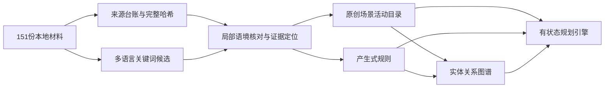

### 知识库规模与课程对应

DateMate 的课程知识库版本为 `knowledge-3.0.1`，包含 38 个场景、66 个可选活动、47 条产生式规则、48 项来源证据，以及 383 个节点和 544 条有向图谱边。场景目录延续交互原型的全部 20 个场景标识，保留 `mall` 与 `mall_arcade`、`mall_stores`、`mall_snacks`，并加入校园简餐、乒乓球、植物观察、轻野餐、物资采购、照片冲印、手作、音乐与短途观景等具体选择。

老师的作业要求包括至少两种主流知识表示方法和一项可运行推理演示。本项目采用知识图谱表示场景、活动、兴趣与准备资源的结构联系，采用产生式表示条件匹配、事实推导、候选过滤和偏好加分。场景与活动具有统一的属性槽位，也可以作为框架表示的辅助实例。课件第 43—48 页介绍的 `IF P THEN Q`、规则库、综合数据库、匹配和执行过程，对应本项目的规则 JSON、上下文事实和前向推理；第 68—72 页的实体关系三元组、模式层和数据层，对应图谱节点类型、关系名称及具体边。

### 原材料登记与采用状态

构建脚本对语料目录中的 151 份文件完成全文本扫描、严格解码和 SHA-256 登记。资料分布为文学剧情 82 份、经验描述 39 份、现实场景 4 份、学术参考 7 份、游戏专辑 12 份、组员整理材料 7 份。所有文件均成功解码，登记覆盖率为 151/151。`data/source-registry.json` 逐文件保存相对路径、字节数、字符数、行数、编码、完整哈希、文件声明的来源链接与许可信息，以及各主题候选命中数。

关键词抽取涵盖自然、文化、餐饮、游戏、创作、音乐、天气、疲惫、准备、预算、交流和同意等 12 类线索，并支持中文、英文与日文常见词。一个文件可以包含多个类别，一个词也可能进入多个匹配统计，因此命中数表示候选发现次数。它不能用于计算独立事实数量、真实性、关系效果或语料质量评分。

26 份来源形成了正式采用证据，共计 48 个定位项。每项证据保存 `sourceDocumentId`、行号 `sourceLocator` 和该行的 `anchorSha256`，配合整份文件哈希，可以核对本地材料与定位内容。采用范围包括原型使用的 P/G/C 整理材料、校园本地经验、校园和城市背景描述、部分文学线索、研究摘要，以及八部大体量游戏文本中的局部线索。游戏来源分别涉及茶点小店、图书馆阅读、博物馆、附近书店、资料查询和设施可用性确认，相关摘要说明各自的叙事背景。

其余 125 份来源完成登记和候选抽取，保留逐文件的 `candidateHits` 与采用状态。当前 `exclusionReason` 为“仅完成候选抽取，未形成经人工核对的采用项”。这种记录让后续维护者能直接找到尚待审查的材料。局部采用状态表示已核对一个可定位主题线索；全文语境、原作品归属及采集真实性仍具有独立的核验工作。

公开知识文件保存原创改写摘要、结构化目录和设计参数。证据对象的 `publicExcerptAllowed` 为 `false`，原文摘录字段为空，生成文件中未写入小说或游戏全文。来源链接与作者、许可声明由所提供文件登记，许可的实际适用条件仍需在公开复用原文之前回源确认。

### 数据字段与参数性质

`data/catalog.mjs` 导出 `catalog`、`rules`、`graph`、`sources`、`evidence` 和 `conditions`，并提供默认 `catalog` 导出。`catalog.rules` 和 `catalog.graph` 引用相应导出对象，因此 `createPlanner(catalog).plan(context, exploration, prefix)` 可以直接访问知识。独立 JSON 文件适用于审查和课程材料中的局部示例。

场景保留原型的 `id/title/description/minutes/cost/load/kind/area/indoor/fit/novelty/source/activities/default/quiet/mental/bold`，并补充 `typeId/tags/weather/evidenceIds/preparationIds/predecessorIds/requires/preconditions/provides/consumes/windows/dietaryTags/featureValues/reviewStatus`。活动同样提供先后依赖、资源产生和消耗、时间组合模式与明确同意标志。`activities` 既在场景内嵌，也在目录顶层提供扁平索引；两处的活动 ID 唯一且一致。

`minutes` 使用分钟，`cost=[low,high]` 使用人民币元，代表两人整段的模型估算；引擎内部转换为整数分核算。场景基线和所选活动分别记账，`compositionMode='included'` 的风格活动采用零额外时长与费用。`load` 是允许恢复量为负的设计负担单位，`fit/novelty` 和规则 `amount` 为可解释的排序参数。参数对象统一带有 `parameterStatus='designed_not_measured'`。来源中的陈述、叙事线索、研究关联和本项目设计值具有不同证据性质，当前数据明确保存这些边界。

场景 `windows` 使用一天内的绝对分钟。默认演示时间窗为 `840..1020`，即 14:00—17:00；日间博物馆、植物观察和饭点简餐的设计窗口会据此过滤。窗口反映模型约束，现实开放时间和预约情况需要用户通过 `opening_checked` 等准备项确认。

`data/activities.mjs` 提供 13 项兴趣 ID 和中文标签，以及 19 项准备或可产生资源、7 项饮食标签。导出接口为 `interestTags`、`interestOptions`、`preparationOptions` 和 `dietaryOptions`，后三者均使用 `{id,label}`。兴趣包括自然、文化、餐饮、游戏、创作、浪漫、安静、室内、运动、学习、日常、拍照和音乐。

### 可执行推理与状态示例

疲惫演示以 `fatigueA=7`、`fatigueB=2` 开始。`R-fatigue-derive` 匹配任意一方疲惫值不低于 6，产生 `derived.needsRecovery=true`。`R-fatigue-rest` 消费该推导事实，为独立休息场景加分；`R-fatigue-scene` 和 `R-fatigue-activity` 分别过滤高负担场景与活动。这条链包含输入事实、产生式、派生事实及后续操作，可以展示综合数据库在推理过程中发生变化。当前引擎的运行抽查已经验证事实生成、休息加分和高负担过滤。

雨天规则匹配 `context.weather='rain'` 与 `scene.indoor=false`，过滤露天候选。天气未知时保留可选择范围并生成核对提示。安静要求、人流回避、双方共同兴趣、日常或浪漫主题、短时间、预算目标与准备资源由独立规则处理，明示硬限制优先于排序加分。

饮食规则仅消费用户明确提供的 `dietaryRestrictions`。双人简餐场景的 `dietaryTags=[]`，可选的 `meal_style_raw` 与 `meal_style_spicy` 分别携带 `raw` 和 `spicy`。运行抽查已确认同时限制生食与辣味时，普通简餐仍可选，相应风格活动被过滤。所有简餐风格活动处于同一个 `meal_style` 单选组。目录按食物类型记录乳制品、麸质、肉类、冷食和咖啡因等标签，未由人格、性别、经期或剧情自动推断饮食限制。

准备、资源和先后依赖直接进入阶段校验。`campus_tabletennis` 需要 `racket` 与 `ball`，缺少装备时引擎返回准备约束；`purchase_picnic` 产生一份 `picnic_pack`，`picnic_share` 需要并消耗这一份资源，消费后数量归零；`photo_print` 的 `predecessorIds=['photo_pair']`，并需要先前生成的拍照资源。共同拍照与个人分享类活动带有 `requiresExplicitConsent`，由主线交互收集活动级同意后传给引擎。

### 图谱关系与查询

图谱节点包括场景、活动、体验属性、资源、规则、证据和来源。边保存 `subject/predicate/object/evidenceIds/assertionKind`，覆盖 `has_feature`、`allows_activity`、`requires`、`provides`、`consumes`、`follows`、`supported_by` 和 `derived_from`。所有边均指向已登记节点，证据 ID 均可解析。

从 `campus_tabletennis` 到 `resource:racket` 的路径返回准备依赖及校园经验的证据。从 `groceries` 经 `purchase_picnic` 到 `resource:picnic_pack` 的两跳路径返回采购活动与其产出的资源。从 `photo_print` 到 `photo_pair` 可以查询先行活动。引擎还通过场景、体验属性和用户明示偏好的路径生成偏好匹配解释，使结构化知识参与评分。

544 条边包含可执行目录关系与来源追溯关系，计数采用去重后的完整三元组身份。关系中涉及费用、负担或排序的内容具有设计属性。资料中的研究结论用于解释共同新体验和专注交流的设计动机，研究样本与日常校园使用场景之间存在差异，相关标签不输出亲密关系成功率或现实因果判断。

### 构建与验证

在项目目录运行 `python tools/build_knowledge.py` 可以重新生成目录、规则、图谱、证据、来源登记、条件定义、抽取报告和标签模块。脚本默认读取相邻的 `语料资料` 与 V2.0 原型目录，也支持 `--corpus`、`--prototype`、`--output` 指定路径。复现需要相同的原材料文件和目录路径；来源 ID 根据相对路径生成，文件哈希用于校验内容。

构建时通过 23 组数据断言，覆盖规模下限、ID 唯一性、时间和费用边界、证据关联、节点引用、资源存在、前置活动、休息无活动、商场演示 ID，以及简餐饮食标签边界。`data/extraction-report.json` 保存这些结果、主题统计和构建输入摘要。

`data/reproducibility-report.json` 记录连续两次构建的逐文件 SHA-256。目录、模块、规则、图谱、证据、来源登记、条件、抽取报告和标签模块共 9 个生成文件逐字节一致。输出不使用当前时间、随机数或隐含交互历史。

`data/integration-validation.json` 记录当前共享工作区引擎的真实调用检查，涵盖疲惫事实链、高负担过滤、雨天过滤、可选饮食限制、装备图谱路径、采购图谱路径、标签接口、普通简餐可行性、野餐资源产生和消耗，以及乒乓球准备失败。完整的规划性能、浏览器交互与课程交付验收由主线测试记录承接。

### 当前维护边界

全部材料已经进入登记与候选抽取流程，125 份候选来源仍有后续人工审查空间。自动关键词匹配可能命中角色职业、环境描写、否定语境或与约会无关的句子；正式证据采用局部语境核对与原创摘要，扩充目录时仍需对相关上下文作独立判断。

现实场景的数据以类型与条件为主。商家经营、收费、预约、入校、设备可用性和天气均需要当次确认。准备资源和时间窗让这些条件能进入可执行校验；它们的确认状态应来自用户或可靠的当次信息。后续更新可在现有来源、证据、目录、规则与图谱关系中增加版本记录，并重新执行相同构建与验证流程。
